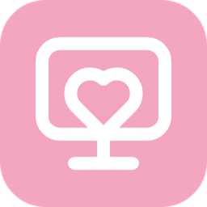
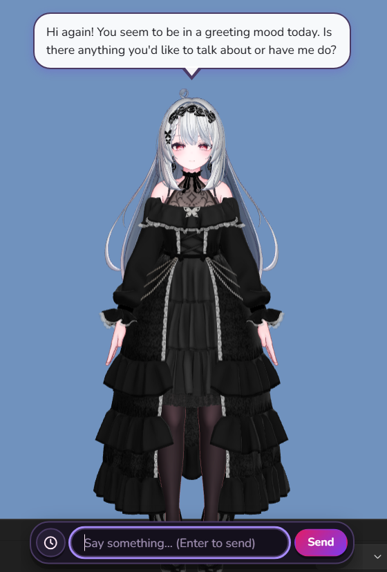
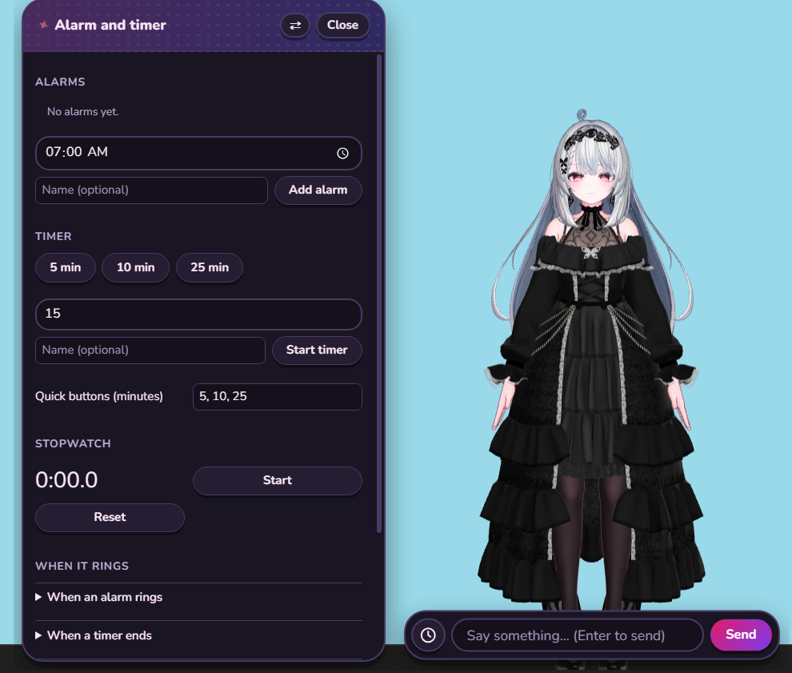
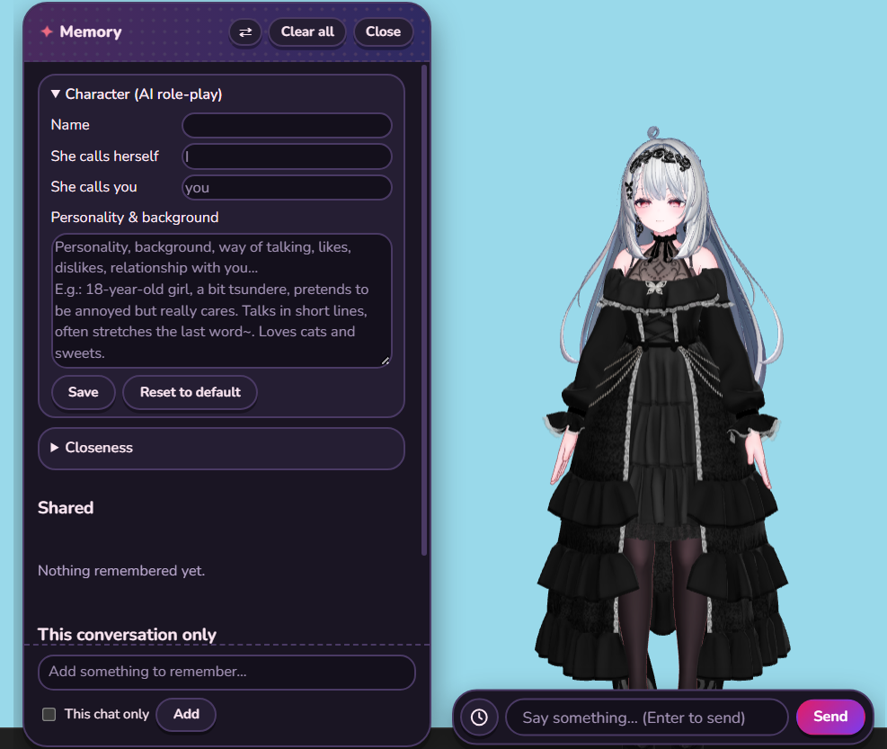
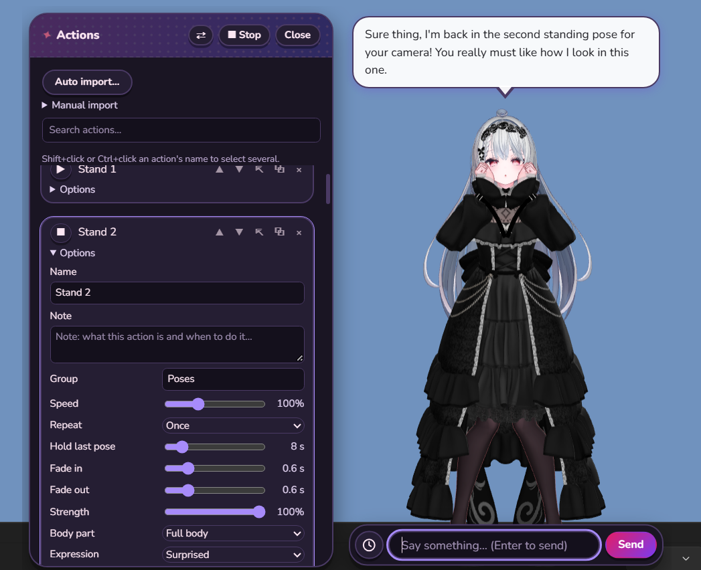

  

  # DeskMuse

  **A little anime companion who lives on your desktop.**

  She stands at the edge of your screen, chats with you, remembers what you tell her, 
  and notices what you're doing. Pat her head, pick her up, or just let her 
  keep you company while you work.

   

  
   
  <em>She chats with you right on your desktop</em>

## Get started

1. [Download `DeskMuse-portable.zip`](https://github.com/BaoZh12/DeskMuse/releases/latest/download/DeskMuse-portable.zip) and extract it anywhere. Nothing to install.
2. Run `DeskMuse.exe`.
3. Right-click her, open **Settings**, and add an AI connection (none is set up by default).
4. **Want more?** Import your own character from the same menu. The built-in character is
   locked for Actions and Wardrobe; your own model unlocks everything.

> **Portable by design:** Your characters, outfits and animations are stored in the app
> folder, so moving or backing it up is just copying the folder.

## What she can do

- **Talk like a person.** Chat through any OpenAI-compatible AI (Gemini, OpenAI, Claude,
  OpenRouter, DeepSeek, or a local one like Ollama). Her mood shows on her face.
- **Remember you.** Your name, your plans, the things you like. She brings them up later.
- **See what you're doing** *(optional)*. She can look at your active window and comment on it.
- **React to touch.** Pat her head, lift her, drop her, or lead her by the hand.
- **Dress up and move.** Import your own VRChat/Booth avatars, VRM models and outfits,
  and play your own animations.
- **Keep you on track.** Alarms, timers, and a sleepy mood at night. She can speak out
  loud if you connect a voice service.
- **Stay light.** She lives in the tray and hides when a game goes full screen.

## Screenshots

|  |  |  |
| :---: | :---: | :---: |
| **Alarms and timers** | **Memory** | **Actions** |

## Good to know

- **Importing is still experimental.** Importing your own characters, outfits and animations (VRChat/Booth packages, VRM, FBX and more) is still being tested. Some models may fail to load, look wrong, or need manual fixes. If one doesn't work, use **Save error report** in the Character or Wardrobe panel and send it along.

> **Windows SmartScreen ("Unknown publisher")**
>
> Windows may say "Unknown publisher", because the app isn't code-signed yet.
> Click <kbd>More info</kbd>, then <kbd>Run anyway</kbd>.

- **Language:** the app's interface is English only for now. She chats in whatever language you talk to her in.
- **Early release:** This is an early release. If something breaks, the app can save an
  error report for you to send.

  Free for personal use, all rights reserved. 
  Built-in character by 半熟りんご, used under the VN3 License. See <code>LICENSES.txt</code>.

